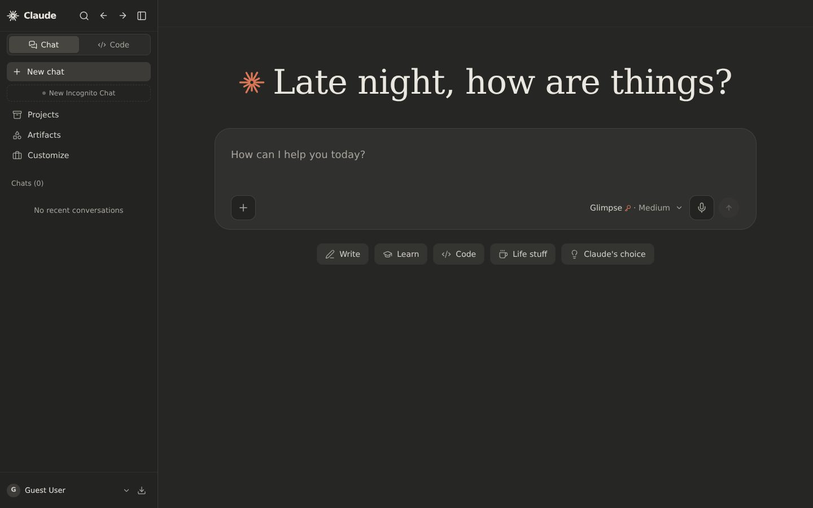
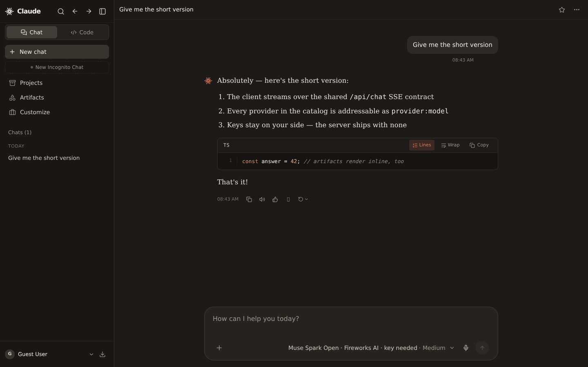
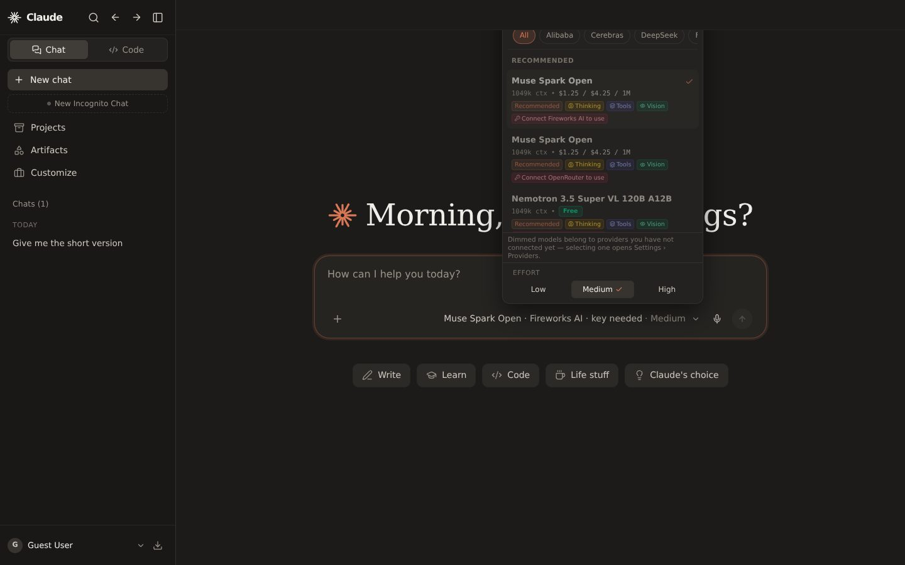
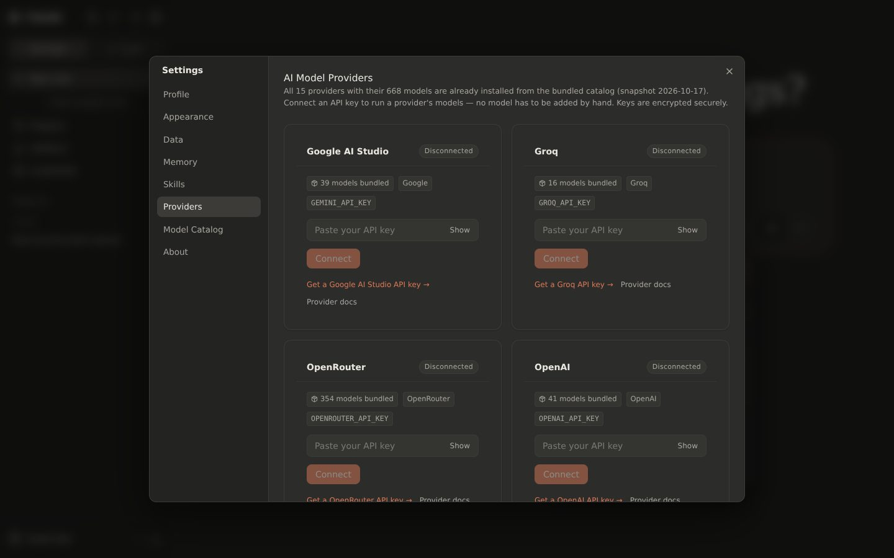
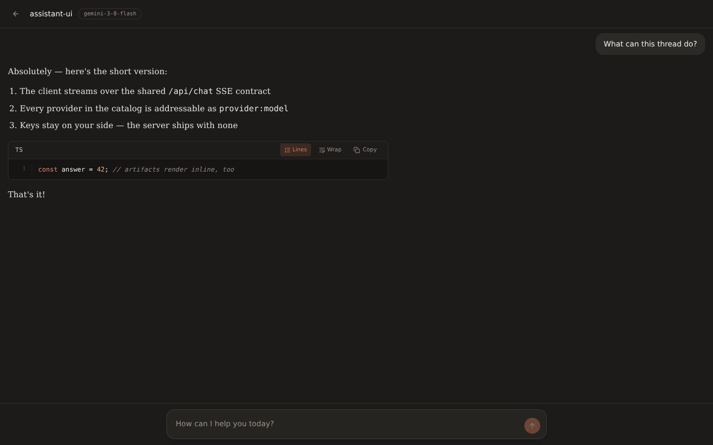
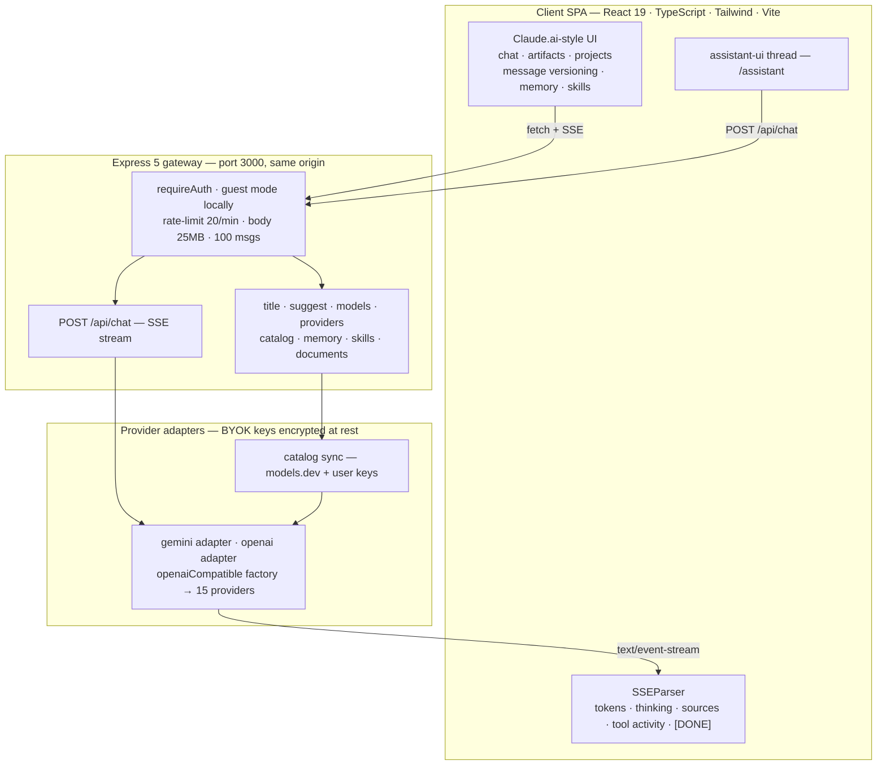
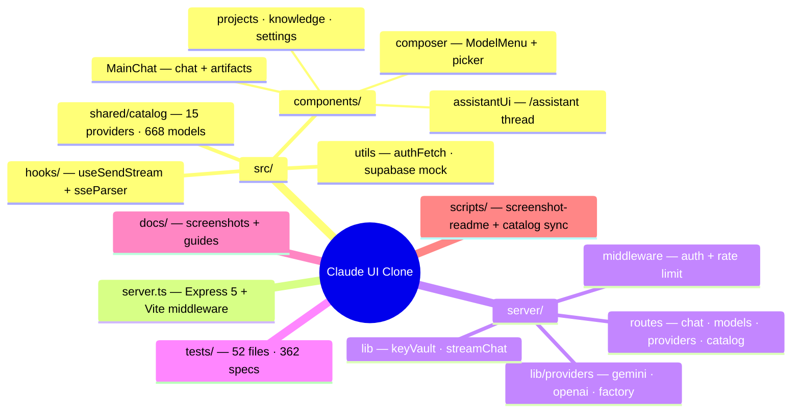

# Claude UI Clone

A high-fidelity clone of the Claude.ai chat experience — built with **React 19**, **TypeScript**, **Tailwind CSS 4**, **Vite** and an **Express 5** gateway streaming over **Server-Sent Events**.

- **15 providers · 668 models** bundled out of the box (OpenAI, Gemini, Groq, OpenRouter, Cerebras, DeepSeek, xAI, Mistral, Together, Fireworks, NVIDIA, Qwen, Moonshot, Z.ai and more) — switch models from the composer, connect a key, done.
- **Bring your own key** — the server ships with **zero AI secrets**; every call runs on the API key each user saves in *Settings → Providers*, encrypted at rest with `PROVIDER_KEY_ENCRYPTION_SECRET`.
- **Claude.ai parity features** — message versioning & branching (`‹ 2/3 ›`), interactive artifacts with live preview, projects + knowledge base, Google-search grounding, extended thinking, personal memory, skills.
- **assistant-ui thread** embedded at **`/assistant`**, streaming through the same SSE pipeline.
- **Local testing needs no login** — a bare `npm run dev` boots straight into the app with a guest session (production only ever accepts a real Supabase session).

<p align="center">
  
</p>


---

## Screenshots

Captured live from the running app (regenerate with `node scripts/screenshot-readme.mjs` while `npm run dev` is up):

| Home & composer | Streaming reply with code artifact |
| :---: | :---: |
|  |  |

| Model catalog picker (668 models) | Provider keys — Settings → Providers |
| :---: | :---: |
|  |  |

**assistant-ui thread at `/assistant`:**



---

## Quick Start

```bash
git clone https://github.com/revolover00/Claude-clone.git
cd Claude-clone
npm install
npm run dev          # → http://localhost:3000
```

That is the entire local setup:

- **No sign-in screen** — outside production the server defaults to guest mode and the client creates a local mock session automatically (opt out with `ALLOW_GUEST=false` / `VITE_ALLOW_LOCAL_MODE=false`).
- **No AI key on the server** — paste your own key in **Settings → Providers** (a free Groq or Google AI Studio key works) and every model of that provider unlocks live.
- Run the full gate before contributing: `npm run check` (tsc + eslint + vitest + vite build).

---

## Supported Providers

Every provider is bundled with its **original brand icon** and complete model list. Save one key in **Settings → Providers** and its models unlock live in the composer — keyless models stay visible but dimmed with *Connect <provider> to use*.

| | Provider | Models | API key (Settings → Providers) | Free tier |
| :---: | --- | ---: | --- | :---: |
|  | **Google AI Studio** | 39 | `GEMINI_API_KEY` | ✓ |
|  | **OpenAI** | 41 | `OPENAI_API_KEY` | — |
|  | **xAI** | 13 | `XAI_API_KEY` | — |
|  | **Mistral** | 20 | `MISTRAL_API_KEY` | — |
|  | **DeepSeek** | 2 | `DEEPSEEK_API_KEY` | — |
|  | **Groq** | 16 | `GROQ_API_KEY` | ✓ |
|  | **Cerebras** | 2 | `CEREBRAS_API_KEY` | — |
|  | **Together AI** | 18 | `TOGETHER_API_KEY` | — |
|  | **Fireworks AI** | 23 | `FIREWORKS_API_KEY` | — |
|  | **NVIDIA NIM** | 56 | `NVIDIA_API_KEY` | — |
|  | **Qwen (Model Studio)** | 58 | `DASHSCOPE_API_KEY` | — |
|  | **Moonshot AI (Kimi)** | 4 | `MOONSHOT_API_KEY` | — |
|  | **Z.AI (GLM)** | 18 | `ZAI_API_KEY` | — |
|  | **Perplexity** | 4 | `PERPLEXITY_API_KEY` | — |
|  | **OpenRouter** | 354 | `OPENROUTER_API_KEY` | — |

**668 models** in total · bundled snapshot `2026-10-17` · source: [models.dev](https://models.dev) (MIT) · refresh with `npm run catalog:sync`.

---

## Features

- **assistant-ui Thread at `/assistant`**: a full-page chat surface powered by [`@assistant-ui/react`](https://github.com/assistant-ui/assistant-ui) (`useExternalStoreRuntime`) streaming through the exact same `/api/chat` SSE pipeline as the main chat — see [assistant-ui Integration](#assistant-ui-integration).
- **Zero-friction local development**: guest mode is on by default outside production (`npm run dev` → straight in, no login), while deployments only ever accept a real Supabase session.
- **Full Message Versioning & Branching**:
  - Editing any user message or clicking "Retry response" creates a new sibling branch in the conversation tree (`parentId` + `activeChildId`) without destructive overwrites.
  - Interactive `‹ 2/3 ›` switcher under user messages and assistant responses to freely toggle between variants.
  - Switching versions instantly swaps the downstream dialogue branch.
- **Portable read-only conversation sharing**: creates a compressed link for the active message branch and opens it without an account or server-side share record. The link intentionally excludes attachments, hidden reasoning, and alternate versions; it is an immutable snapshot, cannot be revoked, and anyone with the link can read it.
- **Interrupted reply recovery**: after a page reload, stale streaming state is cleared while any generated text is preserved; partial replies offer Continue and empty replies can be retried. Continuation includes the saved assistant text in model context. This is client-side recovery, not durable server-side resumption of the original SSE stream.
- **Custom AI retry directives**: revise an answer with a natural-language instruction (for example, change its language, tone, or level of detail); the previous assistant response is included in context so the model can edit the actual answer rather than guess what it wrote.
- **Visible AI tool activity**: watch skill and document tools start, finish, or fail in a compact, expandable timeline under the reply. The UI shows action names and status only—not private tool arguments or returned contents—and keeps completed activity with the message.
- **Projects Workspace (`/projects/:id`)**:
  - Custom system instructions configured per project and automatically injected into every conversation started within the project.
  - Knowledge base supporting file uploads (`.txt`, `.md`, `.json`, code files) and text snippets.
  - Dedicated conversations list scoped to each project.
- **Google Search Grounding**:
  - Live web search enabled with real-time SSE source streaming.
  - Displays "Searched the web" indicator during generation and an interactive "Sources" row with site favicons and external domain links.
- **Bundled Model Catalog (zero manual setup)**:
  - Every supported provider ships with its complete model list in the repository (`src/shared/catalog`), with full details: context window, max output, input/output modalities, tools, reasoning, structured output, vision, open weights, pricing per 1M tokens, knowledge cutoff, release date and lifecycle status.
  - Nothing has to be added by hand: a background **sync service** keeps the `provider_catalog` table fresh — OpenRouter from its public endpoint (no key) and **every other provider through whatever API key a user saved in Settings > Providers** (source `user-key`; skipped while nobody connected that provider). The server never reads AI keys from deploy secrets. Rows are upserted on `(provider, model_id)`; a model is only marked `removed` after it is missing from two consecutive successful full syncs, and never on a failed fetch or when the response shrinks below 50% of the previous count.
  - **Settings → Providers** lists all providers (connected or not) with their bundled model counts, and the **Model Catalog** browser shows every model of every provider, searchable and filterable by kind and capability, with live provider data merged on top when a key is connected.
  - The composer model picker shows the same catalog grouped per provider (Recommended first, then pinned, then provider/vendor groups); models whose provider has no key yet stay visible but dimmed with **Connect <provider> to use**, and selecting one opens Settings › Providers.
  - Providers without a bespoke adapter are wired through a single OpenAI-compatible factory (`server/lib/providers/openaiCompatible.ts`), so adding a provider is a data change.
  - Refresh the snapshot from the public models.dev dataset (MIT) with `npm run catalog:sync` (optionally `-- --from ./api.json` or `-- --only openai,groq`); the generator rewrites `src/shared/catalog/providers/*.ts` and `snapshot.ts`. Model names excluded by the repository naming policy are filtered out during generation.
- **Interactive Artifacts**:
  - Detects React components, HTML/Tailwind, SVGs, and documents with a live right-hand preview panel, version history, copy, and export options.
- **Harden & Secure Server Gateway**:
  - Strict CORS validation (`ALLOWED_ORIGIN`), express-rate-limit (20 req/min), 25MB body limit, 100 messages cap, 100,000 characters per message, and 20MB attachment caps.
  - Live stream cancellation via `AbortController` on client disconnect (`req.on("close")`).
  - Dynamic Vite loading ensuring zero dev dependencies imported in production.

---

## assistant-ui Integration

`/assistant` runs a second, full-page thread built on **`@assistant-ui/react@0.15`** (`useExternalStoreRuntime`) and reuses this app's transport — there is no second backend path:

- `src/components/assistantUi/useAssistantUiStore.ts` — external-store adapter; `onNew` streams through the shared `streamRealResponse` client into `POST /api/chat` with the same auth headers, abort handling and error mapping as the main composer.
- `src/components/assistantUi/AssistantUiThread.tsx` — `AssistantRuntimeProvider` with Thread/Composer primitives and custom rows (markdown via the shared `MarkdownView`, thinking dots, stopped/error notes), themed from the app's design tokens.
- Registered as a pathname view in `App.tsx` (same pattern as `/motion`), so the main chat flow is untouched.

---

## Architecture Diagram



---

## Project Structure



---

## API Reference

All routes are same-origin under `/api`. 🔒 routes require a session (`requireAuth`; most are additionally rate-limited to 20 req/min/IP).

| Method & route | Auth | Purpose |
| --- | :-: | --- |
| `POST /api/chat` | 🔒 | SSE chat stream: tokens, thinking, sources, tool activity, warnings, `[DONE]` |
| `POST /api/title` | 🔒 | 3–6 word conversation auto-title |
| `POST /api/suggest` | 🔒 | Follow-up suggestion chips |
| `GET /api/models` | 🔒 | Enabled model list for the picker |
| `GET/PUT /api/models/prefs` | 🔒 | Per-user pinned / enabled / alias model preferences |
| `GET /api/providers` | 🔒 | Provider registry + saved-key status (keys are never returned) |
| `GET /api/catalog` | 🔒 | Full model-catalog browser payload |
| `GET/POST/DELETE /api/memory…` | 🔒 | Personal memory CRUD + background extraction |
| `GET /api/skills`, `POST /api/skills/…` | 🔒 | Skills list, instructions, source & toggle |
| `POST /api/documents` | — | Document parsing (PDF / DOCX / PPTX / XLSX) |
| `GET /api/auth/debug` | — | Auth diagnostics (always answers) |
| `GET /api/health` | — | Liveness, auth mode, enabled models |

In development the same Express process also mounts the Vite dev middleware, so one process serves the SPA and the API on port 3000.

---

## Environment Variables

Create a `.env` file in the root directory (based on `.env.example`).

> **No server-side AI keys.** The server never reads `GEMINI_API_KEY`, `GROQ_API_KEY` or any other provider secret from the environment or your deployment platform. Every AI call — chat, titles, suggestions, memory, skills and catalog sync — runs on the API key each user saves in **Settings > Providers**. When a user has not added a key yet, the app asks them to add one (chat shows an *Add API key* button that opens Settings > Providers).

| Variable | Required | Default | Description |
| :--- | :---: | :---: | :--- |
| `PORT` | No | `3000` | Port for the full-stack server (default is 3000). |
| `ALLOWED_ORIGIN` | No | Same-origin only | Allowed CORS origin (e.g. `https://yourdomain.com`). If unset, requests are restricted to same-origin. |
| `ALLOW_GUEST` | No | `true` (outside production) | Development/test only: lets `requireAuth` accept guest/mock bearer tokens — on by default so a bare `npm run dev` needs no login. Set to `false` to opt out. Never honoured when `NODE_ENV=production`. |
| `VITE_ALLOW_LOCAL_MODE` | No | `true` (in development) | Development only: the client creates a local mock session so the app works without a Supabase project — on by default in dev; set to `false` to require a real sign-in. |
| `VITE_BRAND_LOGO_URL` | No | unset | Opt-in URL for externally hosted brand artwork; the app uses its local vector mark by default. |
| `NODE_ENV` | No | `development` | Set to `production` when building for deployment. |
| `PROVIDER_KEY_ENCRYPTION_SECRET` | **Yes (production)** | unset | secret used to encrypt saved provider API keys at rest — any strong **non-empty** value works (it is normalized to a 32-byte key via SHA-256). Recommended: `openssl rand -base64 32` (or `openssl rand -hex 32`). The server **exits on boot** in production only when it is missing or empty. |
| `PROVIDER_KEY_ENCRYPTION_SECRET_PREV` | No | unset | Previous secret, only needed during key rotation (old ciphertexts decrypt with it and re-encrypt with the primary). |

---

## Local Development Without Supabase

Every user-scoped endpoint (`/api/chat`, `/api/skills`, `/api/providers`, `/api/models/prefs`, ...) is guarded by `requireAuth` and expects the bearer token of the active session, so they answer `401` whenever no auth mode applies. To try the app locally with no Supabase project, just run:

```bash
npm run dev
```

- Outside production, guest mode is **on by default**: the client creates a local mock session (no login screen; `authFetch` in `src/utils/authHeaders.ts` has a token to attach) and the Express middleware accepts it.
- `VITE_ALLOW_LOCAL_MODE=false` disables the client-side mock session, `ALLOW_GUEST=false` disables server-side guest access — use either to test the real login flow locally.
- Production never honours these flags: the server rejects guest/mock tokens there, so deployed endpoints only accept a real Supabase session.

Requests never carry a hard-coded token: `authFetch` reads the access token from the live Supabase session on every call. Tokens are never copied into `localStorage` (the session already lives in Supabase's own storage; a leftover `supabase_token` key from older builds is deleted on startup).

---


## Authentication Failures & Diagnostics

**Server (`requireAuth`).** Every rejection is still `401` with a short human message, plus a machine-readable `code`:

| Code | Meaning |
|---|---|
| `AUTH_HEADER_MISSING` | No `Authorization` header was sent. |
| `AUTH_HEADER_MALFORMED` | The header is not `Bearer <token>` or the token is empty. |
| `AUTH_TOKEN_INVALID` | Supabase rejected the token. |
| `AUTH_TOKEN_EXPIRED` | Supabase rejected the token because it expired. |
| `AUTH_UNAVAILABLE` | The server could not verify the token (Supabase unreachable, timed out, or auth not configured). |

Each failure writes one log line with only metadata: method, path (no query string), code, whether a header was present, its scheme, the token length, host, origin and browser family. The token, or any part of it, is never logged.

`GET /api/auth/debug` needs no auth and is rate-limited (20 requests/minute per IP). It returns only `{ serverMode, hasAuthHeader, scheme, tokenLength, verified, userIdPrefix, errorCode }`, where `userIdPrefix` is the first 6 characters of the user id.

**Client (`authFetch`).** Before a request, the session is refreshed if it is missing or expires within 60 seconds. A `401` with an `AUTH_*` code triggers one refresh and one retry. If that still fails, `authFetch` dispatches `claude:session-expired`. Only one refresh runs at a time; concurrent callers share the same promise. `AUTH_UNAVAILABLE` is retried once without a refresh and never signs the user out. On `claude:session-expired`, or when Supabase drops the session after a failed background refresh, `AuthContext` signs out locally and shows the login screen with "Your session expired, please sign in again". After signing in, the user returns to the page they were on.

**UI.** Settings sections show "Your session is not valid" (with **Sign in again**, **Retry** and the code under **Details**) instead of raw HTTP errors. **Settings → About → Connection diagnostics** shows:

- client mode (real Supabase or local mock)
- session state and minutes until the token expires
- whether storage works and whether the app is framed
- the `/api/auth/debug` result

**Copy report** copies all of this without any token. When the app runs inside an iframe, a banner offers to open it in its own tab, because embedded previews can block storage and cookies.

---


## Bundled Model Catalog

The app never starts with an empty model list. `src/shared/catalog` holds a committed
snapshot of every model of every supported provider:

| Provider | Models | Provider | Models |
| :--- | ---: | :--- | ---: |
| Google AI Studio (`gemini`) | 26 | NVIDIA NIM | 65 |
| OpenAI | 39 | Qwen (Model Studio) | 38 |
| xAI | 22 | Moonshot AI (Kimi) | 5 |
| Mistral | 26 | Z.AI (GLM) | 7 |
| DeepSeek | 2 | Perplexity | 3 |
| Groq | 17 | OpenRouter | 129 |
| Cerebras | 4 | Together AI | 10 |
| Fireworks AI | 16 | | |

Each entry carries its details: context window, max output tokens, input/output
modalities, tools, reasoning, structured output, vision, open weights, USD pricing
per 1M tokens (input/output/cache read), knowledge cutoff, release date, and
`alpha`/`deprecated` status.

How it stays current, automatically:

- **Sync service** (`server/lib/catalog/`): fetches through the existing provider
  adapters — OpenRouter's public models endpoint (no key) plus every registered
  provider through an active user key (source `user-key`, no server secrets).
  Providers nobody has connected yet are skipped. Saving a new key triggers an
  immediate background sync for that provider. Every run upserts on
  `(provider, model_id)`; `first_seen_at` is written only on insert, while
  `last_seen_at` / `last_synced_at` always update.
- **Removal rule**: a row is marked `status: "removed"` only after it is missing from
  two consecutive *successful* full syncs. Rows are never deleted (conversations can
  still reference them), and no removals are recorded on a failed fetch or when the
  new count is under 50% of the previous one.
- **Schedule**: the scheduler runs once at startup and then every 6 hours, guarded
  by a database lock (a run started less than 5 minutes ago makes other instances
  skip). Each run writes a `catalog_sync_runs` row (time, added/updated/removed,
  status, error).
- **`GET /api/catalog`** serves the merged catalog (filters for `provider`, `kind`,
  `vendor`, `family`, `capability`, `status`, `free`, `q`, `sort`, cursor
  pagination) and triggers a background sync when the newest `last_synced_at` is
  older than 12 hours. `GET /api/catalog/facets` returns facet counts;
  `GET /api/catalog/sync-runs` and `POST /api/catalog/sync` are admin-only.
- **Settings → Model Catalog** is read-only for regular users; admins can hide a
  model, force-recommend it or set an alias (stored in `catalog_overrides`), and run
  **Sync now** per provider with the run history rendered from `catalog_sync_runs`.
- **App models**: the Gemini chat list is derived from `provider_catalog` (chat
  kind, active/preview) instead of manual rows; the default is the best recommended
  Gemini Flash model unless an admin overrides it. The legacy `models` table stays
  read-only, and `src/shared/fallbackModels.ts` is used only when both the catalog
  and a live fetch fail.
- **`GET /api/providers/:provider/models`** merges the live provider catalog over the
  bundled one. Missing keys are not an error: the bundled list is returned with
  `source: "bundled"` and a `liveError` when a live refresh was attempted.
- **`npm run catalog:sync`** regenerates the committed `src/shared/catalog`
  snapshot from the public models.dev dataset (MIT). The generator filters out names
  excluded by the repository naming policy before writing, and
  `tests/modelCatalog.test.ts` keeps the data, the runtime kind inference and the
  generator in sync.

---


## Available Scripts

```bash
# Start development server (serves frontend + backend via tsx)
npm run dev

# Refresh the bundled provider/model catalog from models.dev (models.dev/api.json)
npm run catalog:sync

# Run full Vitest test suite
npm run test

# Type-check with TypeScript compiler
npm run lint

# Build the frontend single-page application into dist/
npm run build

# Start production server (runs Node.js runtime on dist/)
npm run start
```

---


## Manual Verification Checklist for Message Versioning ("‹ 2/3 ›")

To manually test and verify the Claude.ai message version switcher in the UI:

- [ ] **1. Create Initial Message**:
  - Open the app and start a new chat. Send: `"Explain photosynthesis in two sentences."`
  - Assistant responds with version 1.
- [ ] **2. Retry Assistant Response**:
  - Hover over the assistant message and click the **Retry response** button (circular arrow).
  - A new response variant is streamed.
  - Verify that the `‹ 2/3 ›` switcher appears in the action row below the assistant message.
  - Click `‹` to view version `1/2`; verify the text immediately switches back to the first response.
  - Click `›` to view version `2/2`; verify the text updates to the retried response.
- [ ] **3. Edit User Message**:
  - Hover over the original user message and click the **Edit** (pencil) icon.
  - Change the text to: `"Explain cellular respiration in two sentences."` and press **Save & Submit**.
  - A new branch is created.
  - Under the user bubble, verify the `‹ 2/2 ›` version switcher appears cleanly below the bubble.
  - Toggle between `1/2` and `2/2` using `‹` and `›`.
  - Notice that switching between user message versions automatically swaps the entire downstream branch (including the corresponding assistant reply).
- [ ] **4. Multi-level Branching**:
  - Send a follow-up question while on branch 2.
  - Switch back to user version 1; confirm the conversation history cleanly reflects only the branch-1 lineage.

---


## Extended Thinking & Model Configuration

Extended thinking produces reasoning and thought summaries during response streaming. By default, `Gemini 3.1 Pro (Preview)` (`gemini-3.1-pro-preview`) is configured with `supports_thinking: true`.

> **Note for Administrators**: reasoning capability is derived from the bundled model catalog (`supportsReasoning` per model) and can be overridden per App model with `supports_thinking` in **Settings > Models**. The thinking router also reads the catalog directly for provider models, so non-Gemini providers get the right reasoning level without configuration.

---


## Deployment Notes

This application uses a full-stack architecture where `server.ts` hosts the Express backend API (`/api/chat`, `/api/title`, `/api/health`) and serves the static production build files from `./dist`.

### Deployment Requirements:
1. **Node.js Environment**: The hosting environment must support a persistent Node.js process (e.g. Google Cloud Run, Railway, Render, Fly.io, or an AWS/GCP VPS).
2. **Build Step**:
   ```bash
   npm install
   npm run build
   ```
3. **Execution Command**:
   ```bash
   npm run start
   # Executes: NODE_ENV=production tsx server.ts
   ```
4. **Environment Variables**: No AI key is required on the platform — users connect their own provider keys in Settings > Providers (see the note above). **One secret is mandatory in production**: `PROVIDER_KEY_ENCRYPTION_SECRET` (the server refuses to boot without it). Use any strong non-empty value — recommended: `openssl rand -base64 32` — and set it in your host's environment/dashboard before the first deploy. For local production-mode runs put it in `.env` (see `.env.example`).
